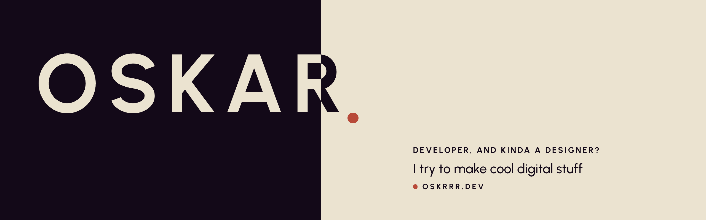

<a href="https://oskrrr.dev">
  <picture>
    <source media="(prefers-color-scheme: dark)" srcset="assets/header-dark.png">
    
  </picture>
</a>

Hi, I'm **Oskar Kopčil** (Oskrrr). I design and build apps, websites and small games, from the first sketch in Figma to working code, and spend the rest of my time on branding, photography and video. Student at Creative Hill College.

**[oskrrr.dev](https://oskrrr.dev)** · [LinkedIn](https://www.linkedin.com/in/oskar-kop%C4%8Dil-b68aa0368) · [kopcil.oskar@gmail.com](mailto:kopcil.oskar@gmail.com)

---

### 01 &nbsp;Selected work

| | Project | |
|---|---|---|
| **01** | **[HearBy](https://github.com/0skrrr/HearBy)** | Turns sound into visuals so deaf and hard-of-hearing people can see tone, emotion, pitch and rhythm. AT&T Hackathon Junior 2026. |
| **02** | **[Predichess](https://github.com/0skrrr/Predichess)** | Build and play interactive chess lessons; players work through positions and questions and earn XP and Elo. [Live demo ↗](https://0skrrr.github.io/Predichess/) |
| **03** | **[Graphite](https://github.com/0skrrr/graphite-releases)** | My second-brain note app: every note a plain Markdown file in a folder you own, on macOS, Windows, Linux and Android. |

More: [Portfolio](https://github.com/0skrrr/Portfolio2) · [VR Game Web](https://github.com/0skrrr/VR-Game-Web) · [nebrecime.cz](https://github.com/0skrrr/nebrecime.cz) · [Codename RUN](https://github.com/0skrrr/Codename-RUN) · [Minecraft mod](https://github.com/0skrrr/MinecraftMod01)

### 02 &nbsp;Toolbox

**Daily drivers:** Figma · Affinity · TypeScript · React · WebStorm · GitHub · Discord · Graphite · Vivaldi 
**Also:** Blender · DaVinci Resolve · Lightroom · Photoshop · Unity · Python · C# · Tauri · SCSS

### 03 &nbsp;Skills

App Design · Web Design · Game Design · UI / UX · Backend · Branding · Photo & Video

---

Full portfolio with case studies at <a href="https://oskrrr.dev">oskrrr.dev</a>.
