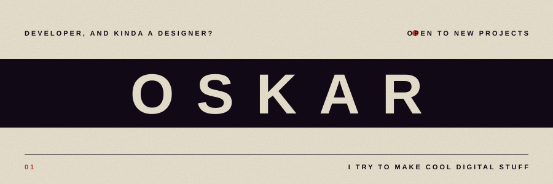
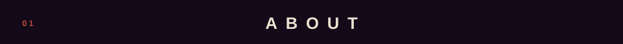
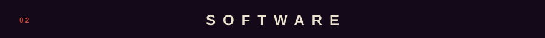
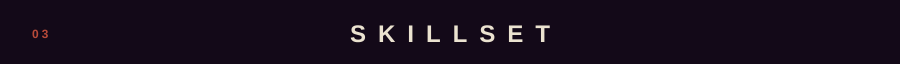
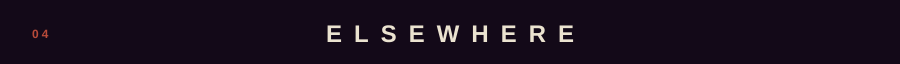

  

**Oskar Kopčil** — designer and developer. I build websites, interfaces and small games, and spend the rest of the time on branding, photography and video.

<code>●</code> Currently open to new projects.

| Plan | Design & media | Build | Ship |
| :-- | :-- | :-- | :-- |
| Notion | Figma | JavaScript · React | GitHub |
| Discord | Photoshop · Illustrator | C# · Java · PHP | |
| | Aseprite · Fusion 360 | MySQL · DataGrip | |
| | Lightroom · DaVinci Resolve | Unity · Rider · WebStorm | |

`01` **App Design** — from the first screen flow to a clickable prototype that feels real.
`02` **Web Design** — responsive sites, designed in Figma and built by hand.
`03` **Game Design** — mechanics, levels and pixel art; small games built to be played.
`04` **UI / UX** — flows and interfaces that feel obvious the first time you use them.
`05` **Backend** — APIs, databases and the logic nobody sees until it breaks.
`06` **Branding** · `07` **Photo & Video**

  
  

